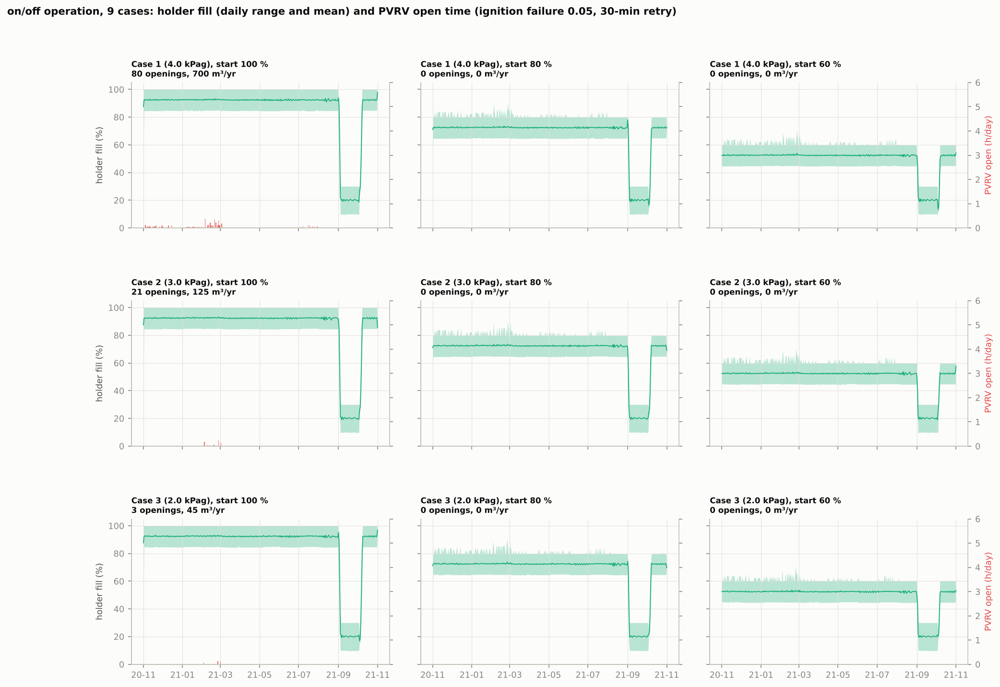
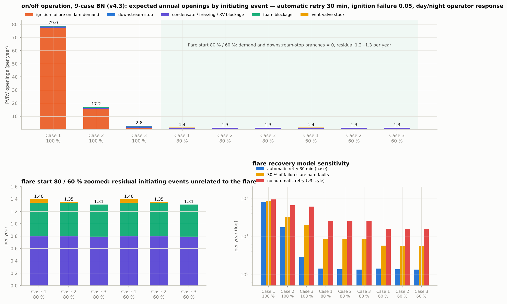

# biogas-pvrv-BN

[](https://colab.research.google.com/github/drinkgarlic/biogas-pvrv-BN/blob/main/colab/Biogas_PVRV_Colab.ipynb)

**When and how often does a pressure/vacuum relief valve (PVRV) open at a food-waste biogas plant?**
A one-second pressure model of two anaerobic digesters feeding a double-membrane gas holder, coupled with a Bayesian network that turns the physics into an hourly and annual opening frequency.

The risk assessment built on these frequencies — release types, dispersion, effects, exposure and the time-resolved individual risk — lives in its own repository, [biogas-pvrv-qra](https://github.com/drinkgarlic/biogas-pvrv-qra), which takes a pinned copy of the network from here.

The case plant is the municipal food-waste digestion facility in Pohang, Korea: two digesters (400 m³ headspace each, 35 °C), a 500 m³ double-membrane gas holder with a weight-loaded air vent valve and a blower, DN200 weight-loaded PVRVs set at 5.0 kPag on the digester roofs, a 60 m³/h gas consumer and a 150 m³/h flare. Gas production comes from a PyADM1ODE simulation of one year of real feedstock data; atmospheric pressure is the KMA Pohang station record for the same year. Nothing in the repository is proprietary, so the whole study can be re-run from the two CSV files in `data/`.

Two questions are answered, one by each package.

| Package | Question | Method | Typical run time |
|---|---|---|---|
| `pressure_model/` | *When* does the PVRV open, given production, holder fill, weather and downstream behaviour? | Lumped ideal-gas model, 1-s time step, one year (31.5 million steps) | < 1 min per year with numba, 12–25 min in pure Python |
| `bayesian_network/` | *How often* per year, given uncertain initiating events, flare reliability and operator response? | One-hour-slice Bayesian network with exact enumeration, physics taken from the pressure model | about one minute for all nine cases |

Headline result: with the holder kept full (flare start at 100 %) the expected number of PVRV openings is 79 / 17 / 2.8 per year for operating pressures of 4.0 / 3.0 / 2.0 kPag, almost all of them caused by flare ignition failures. Starting the flare at 80 % fill or lower removes those openings entirely; what remains is 1.3–1.4 per year from events that do not involve the flare (condensate, freezing, foam, a stuck vent valve). The BN runs on the hourly holder fill and the flare start times of the 1-s model itself (a year without ignition failures), so both tools see the same holder and the same 1,997–2,050 flare demands a year. They agree on the ignition-failure branch: applied to the failures the 1-s simulation actually drew, the BN response functions open exactly the same 80 / 21 / 3 of them. The BN expectations are 77.2 / 15.5 / 1.3 with the operator response and 77.5 / 16.8 / 2.1 without it (the 1-s model has no operator); the rest of the gap is the luck of one random year — 81 ignition failures fell above the Case 1 30-min threshold where 76.7 were expected, 18 above the Case 2 threshold where 13.6 were expected.





---

## 1. Repository layout

```
biogas-pvrv-BN/
├── README.md
├── LICENSE                    MIT
├── requirements.txt
├── data/
│   ├── ADM1_hourly_1to9_Q200_6000m3_ffOTS1.csv       hourly PyADM1ODE output (gas flow, composition), 2020-11-01 .. 2021-11-01
│   ├── kma_asos138_pohang_hourly_pressure_kPa.csv    hourly station pressure, KMA ASOS 138 (Pohang), same period
│   └── README.md
├── pressure_model/                                   package 1: 1-s pressure model
│   ├── pressure_model.py      physics + numerical kernel + input loader (the only file the others really depend on)
│   ├── run_base.py            one-year run, downstream consumes all gas               -> out/base_case{c}_*
│   ├── scan_stop.py           downstream-stop event scan, 8,754 start hours           -> out/stop_case{c}_f{85|50}*.csv.gz
│   ├── make_figs.py           figures and summary tables of the two above             -> fig/, out/summary_base.csv, out/summary_stop.csv
│   ├── run_full100.py         holder kept full, pressure-controlled flare             -> out/full100_*
│   ├── sum_full100.py         its summary and figure
│   ├── run_onoff.py           consumer on/off + flare on/off by fill level (9 cases)  -> out/onoff_*
│   ├── sum_onoff.py           9-case table and figures
│   └── fig_episode.py         one opening episode at 1-min resolution + failure/opening table
├── bayesian_network/                                 package 2: Bayesian network
│   ├── physics.py             closed-form response functions calibrated on package 1
│   ├── pv_bn.py               nodes, parameters with sources, per-slice inference, annual aggregation, CPT export
│   ├── make_onoff_inputs.py   hourly fill + flare start times of the 9 cases from the 1-s model runs without ignition failures (v4.3)
│   ├── run_onoff9.py          the 9 cases (3 operating pressures x 3 flare-start levels) x 3 flare-recovery variants
│   ├── sens_v4.py             one-at-a-time sensitivity (tornado inputs)
│   ├── fig_onoff9.py          figures, including the comparison with package 1
│   ├── make_v3_inputs.py, bn_sens_figs.py, buffer_band.py, crit_weather.py   earlier (v3) analyses, kept for completeness
│   ├── fill_hourly_onoff_c*_f*.csv, flare_demands_onoff_c*_f*.csv             inputs of the 9 cases, taken from the 1-s model (make_onoff_inputs.py)
│   └── fill_hourly_use60.csv, flare_demands_use60.csv                         v3 operating-model inputs
├── colab/
│   ├── run_pressure_model.py      one-command driver (all stages, or --quick)
│   ├── run_bayesian_network.py    one-command driver
│   └── Biogas_PVRV_Colab.ipynb    notebook that clones the repository and runs both drivers
└── results/                       reference outputs of the study (summary tables and key figures)
```

---

## 2. Quick start

### Local

```bash
git clone https://github.com/drinkgarlic/biogas-pvrv-BN.git
cd biogas-pvrv-BN
pip install -r requirements.txt

python colab/run_bayesian_network.py            # ~1 min: nine BN cases, sensitivity, figures
python colab/run_pressure_model.py --quick      # ~5 min with numba: full workflow on the first 30 days
python colab/run_pressure_model.py              # the real thing: 19 one-year simulations + 9 event scans
```

### Google Colab

Click the badge above, or open this link: https://colab.research.google.com/github/drinkgarlic/biogas-pvrv-BN/blob/main/colab/Biogas_PVRV_Colab.ipynb — Colab loads the notebook straight from GitHub, no download needed. The first cell clones the repository and installs the requirements; the following cells run the two drivers and show the figures. Colab ships with numba, so a one-year simulation takes well under a minute after the first compilation, and the full pressure-model workflow finishes in roughly 15 minutes on a standard CPU runtime. Add `--jobs 1` if the runtime runs out of memory (each year simulation holds about 1 GB).

### Quick mode

`PVRV_QUICK_DAYS=30 python pressure_model/run_onoff.py 1 0.8 0.05` runs any single script on the first 30 days only. The driver's `--quick` flag sets the same environment variable for every stage. Use it to make sure the tool chain works before committing to the multi-hour pure-Python run.

---

## 3. Data

`ADM1_hourly_1to9_Q200_6000m3_ffOTS1.csv` is the hourly output of a PyADM1ODE run (Gaida's Python implementation of ADM1) fed with the monthly food-waste composition of the Pohang plant: 200 m³/d of feed, 6,000 m³ of digester volume, interval-end timestamps from 2020-11-01 01:00 to 2021-11-01 00:00. The columns used here are `Q_gas_wet_m3_d_20C` (wet biogas at 20 °C, both digesters), `CH4_wet_pct`, `CO2_wet_pct`, `H2O_wet_pct`, `H2S_gas_ppmv_eq`, `NH3_gas_ppmv_eq` and `H2_dry_ppm`. Production averages 82.4 m³/h, with a minimum of 42.1 and a maximum of 115.1.

`kma_asos138_pohang_hourly_pressure_kPa.csv` holds the station pressure of KMA ASOS site 138 (Pohang) in kPa, converted from the public hourly download. Twenty-five missing hours are filled by interpolation inside the loader. Mean 101.65 kPa, range 99.73–103.53 kPa; the steepest hourly fall is 0.37 kPa/h and the largest daily fall 2.02 kPa.

Both files are read by `pressure_model.load_inputs()` and `pv_bn.load_inputs()`, which linearly interpolate the hourly knots to one second where needed. Temperature is not in the files; the models use fixed values (holder 20 °C, ambient 15 °C) that can be replaced by a column if you have one.

---

## 4. Package 1 — the 1-s pressure model

### 4.1 Physics in one paragraph

The gas side (two headspaces, the piping and the inside of the inner membrane) and the air side (between the two membranes) are each a lumped ideal gas whose inventory is counted in reference cubic metres (20 °C, 101.325 kPa). While the inner membrane is free, both sides share one absolute pressure, `p = c (n_g + n_a) / X` with `c = P_REF / T_REF` and `X = Σ V_i / T_i = 4.894 m³/K`. When the inner membrane reaches the outer one the gas side becomes rigid and its stiffness jumps from 0.0706 to 0.0803 kPa per reference m³; an isolated digester headspace has 0.266. Digester pressure is holder pressure plus the elevation head `(ρ_air − ρ_gas) g Δz` (about 2 Pa/m) plus Darcy–Weisbach friction with Crane minor losses over the piping of drawing ISO-BG-001 REV.1 (21 Pa at average flow, 38 Pa at maximum). The headspace storage term is included in the pipe flow, which is why a blower pulse produces a brief −74 m³/h back-flow. Relief valves are weight-loaded proportional valves referenced to gauge pressure, so their absolute set point moves with the weather. The air side is held by the weight-loaded vent valve WV-202 (proportional, set at the operating pressure) and a blower that starts 0.3 kPa below it.

### 4.2 How the code is organised

**`pressure_model.py`** — everything physical lives here.

- `BASE` (dict): all equipment and operating parameters with their units in the comments; `CASES = {1: 4.0, 2: 3.0, 3: 2.0}` are the operating pressures in kPag.
- `PIPES` / `PIPE_ARR`: the five pipe segments (inner diameter, length, roughness, ΣK). `_K()` builds ΣK from Crane multipliers.
- `dp_pipe()`: Darcy–Weisbach with Swamee–Jain friction factor, laminar below Re 2000, linear blend to 4000.
- `valve_flow()`: proportional valve with stiction and a minimum stable opening; used for the PVRVs, the vacuum pallets and WV-202.
- `kernel()`: the 1-s loop. Reads a flat parameter array (`_prm()` packs `BASE` into it), integrates the two inventories, applies the valve and blower logic and the selected downstream mode, and writes 1-min aggregates, an event log and 1-s records for chosen days. It is decorated with `@njit`; if numba is missing or cannot compile, `run_year()` silently falls back to the identical pure-Python function.
- Downstream modes (`BASE['out_mode']`): `follow` (consumer takes everything), `stop` (nothing leaves), `const` (60 m³/h consumer + pressure-controlled flare), `const_level` (60 m³/h + proportional fill-level flare), `onoff` (consumer on/off with a 10 / 30 % low-low interlock, flare on/off at `f_fl_on` / `f_fl_off`). Ignition failures are drawn with a linear-congruential generator (`seed`) with probability `pfd_flare` per start and a `t_lockout` before the retry, so runs are reproducible.
- `load_inputs()`: reads the two CSV files, builds hourly knot arrays and the gas molar mass and viscosity (Herning–Zipperer).
- `run_year()`: allocates the record arrays, calls the kernel and returns four objects: a 1-min DataFrame (`REC_COLS`), an event DataFrame (PV/WV/blower open-close events with time and pressure), a 1-s DataFrame for the selected days (`SEC_COLS`) and a summary dict (open seconds, vented m³ and kg CH₄ / H₂S, blower and vent-valve statistics, flare starts and failures, consumer stops).

**`run_base.py <case>`** — one year in `follow` mode. Writes `out/base_case{c}_1min.csv.gz`, `_events.csv`, `_1s_selected_days.csv.gz`, `_summary.json`.

**`scan_stop.py <case> <f0> [f_min_PV] [abs]`** — the downstream-stop scan. Instead of one long simulation it takes every full hour of the year as the start of a six-hour `q_out = 0` event and advances all 8,754 events together, vectorised with numpy. Same equations as the kernel, including the 6-s pipe lag. Output: one row per start hour with the time to holder full, time to first opening, openings and vented volume in the first and second hour after opening, checkpoints at 2 / 4 / 6 h and the maximum PT. The optional arguments reproduce the sensitivities of the study (minimum stable opening 0 / 25 %, absolute set pressure).

**`make_figs.py`** — year and day figures of the base runs, the scan figures, and the chattering comparison (`fig_chatter()` re-runs a short scalar simulation for three minimum openings). Writes `out/summary_base.csv` and `out/summary_stop.csv`.

**`run_full100.py <case> <pfd>`** and **`sum_full100.py`** — holder kept full with a flare that starts at `p_op + 0.5` kPa and stops at `p_op + 0.1` (`const` mode). This is the regime reported in the literature to give frequent PVRV emissions, and it does: 1,294 opening episodes a year in Case 1 with PFD 0.05.

**`run_onoff.py <case> <f_on> <pfd>`**, **`sum_onoff.py`**, **`fig_episode.py`** — the nine-case study (`onoff` mode). `f_on` ∈ {1.0, 0.8, 0.6}, flare stop at `f_on − 0.15`, consumer stop at 10 % fill and restart at 30 %, PFD 0.05 with a 30-min automatic retry. The summary script computes opening episodes (gaps > 10 min start a new episode), fill statistics, flare starts and failures, consumer stops, vented CH₄, and the air-side counts. `fig_episode.py` also writes `out/onoff_f100_failures.csv`, which lists every ignition failure with the gas production at the time and whether it led to an opening. The same nine cases are also run with PFD 0 (`run_onoff.py <case> <f_on> 0.0`); those failure-free years are the input series of the Bayesian network (v4.3).

### 4.3 What the model found

| Operating regime | PVRV openings per year (Case 1 / 2 / 3) | Comment |
|---|---|---|
| Downstream consumes all gas | 0 / 0 / 0 | PT stays within 3.73–4.12 kPag (Case 1); weather alone never opens the valve |
| Downstream stop from 85 % fill | first opening after 65 / 73 / 81 min (median) | time to fill dominates; the rigid phase adds 8.6 / 17.5 / 26.5 min at 82 m³/h |
| Holder full, pressure-controlled flare, PFD 0.05 | 1,294 / 537 / 31 episodes | 2.2 % of production vented in Case 1 |
| On/off, flare start 100 %, PFD 0.05 | 80 / 21 / 3 episodes | opens only when production exceeds 83.4 / 108.3 / 133.2 m³/h during a failure |
| On/off, flare start 80 % or 60 % | 0 / 0 / 0 | a failure merely raises the fill by 4–10 %; the price is ~170,000 vent-valve and ~28,000 blower operations a year |

The threshold in the fourth row follows from `(q − 60) · k_full · 0.5 h > Δp_eff`, i.e. production must exceed `60 + Δp_eff / (0.0803 × 0.5)` for the pressure to reach the valve before the 30-min retry. It is the single most useful number the model produces, and the BN is built around it.

---

## 5. Package 2 — the Bayesian network

### 5.1 Idea

The year is cut into 8,760 one-hour slices. In each slice the evidence (production, holder fill, day/night, winter) is known from the operating time series, and the network asks: if an initiating event starts now, will the PVRV open before the situation is recovered? Six initiating events are considered — none, downstream stop, flare start demand, foam blocking a digester outlet, condensate / freezing / shut-off-valve blockage, and a stuck weight-loaded vent valve. The intermediate nodes are the stop duration D, the flare's behaviour on demand (success, transient failure cleared by an automatic retry, or a hard fault that needs the operator), the operator response R (day/night), foam fouling of the PVRV itself (B) and, for the stuck vent valve, whether the atmospheric ratchet reaches the valve within the inspection interval (L). The physics enters as closed-form response times calibrated on package 1. Because the network is small, inference is exact enumeration; no sampling, no approximation.

### 5.2 How the code is organised

**`physics.py`** — `margin_eff(case)`, `t_full_h()`, `t_rigid_h()`, `t_iso_h()`, `wv_stuck_ratchet()` and `operating_year()`. The last one is a simple 1-min operating model (consumer + flare logic on the holder). Up to v4.2 it produced the input series of the nine cases; it counts the holder as 500 reference m³ without converting the gas at 2–4 kPag, so it demanded the flare 2,103 times a year where the 1-s model demands it 1,997–2,050 times. Since v4.3 the nine cases read the 1-s model's own series (`make_onoff_inputs.py`); `operating_year()` is kept for the v3 analyses.

**`pv_bn.py`** — the network.

- `PARAMS`: every number with its unit and source. Initiating-event frequencies (downstream stops 12/yr, power cuts 0.1/yr, foaming 2/yr, condensate 0.5/yr, shut-off valve 0.1/yr, freezing 0.2/yr in winter, stuck vent valve 0.1/yr), the flare PFD (0.05), the response-time distributions, the retry logic (`t_retry_h`, `n_retry`, `p_hard`), the flare start level `f_on`, the `pressure_backup` switch and the optional nodes (level-indicator bias, stuck PVRV, reseat failure).

  **v4.1 (2026-10-21).** The probability that foam reaching the outlet also fouls the PVRV (`p_pv_fouled`) is 0.1 instead of 0.3 — the same value the QRA uses for its seal-failure chain, so that both packages read one parameter (sensitivity 0.03–0.3); the foam branch of the 80 % cases rises from 0.42 to 0.54 openings a year. The stuck-PVRV node now carries a sourced value: NOG-070 (2020) Table A.2.1 gives λ_DU = 1.1 × 10⁻⁶ /h for a PSV that fails to open before the test pressure, i.e. PFD = 4.8 × 10⁻³ per demand with an annual proof test (`p_pv_stuck`); the shared header is protected 1oo2 with β = 0.1 (`beta_pv`), an isolated digester by one valve. `summarize()` and `bn_onoff_9cases.csv` report the resulting overpressure frequency (0.047 / 0.015 / 0.007 per year at 100 %, 0.006 at 80 %) next to the foam-fouling overpressure (0.06 per year). These are the initiating frequencies of the no-relief chain in [biogas-pvrv-qra](https://github.com/drinkgarlic/biogas-pvrv-qra).
  **v4.2 (2026-10-26).** The flare demand at a 100 % start level was evaluated at 99.9 % fill (`min(f_on + b, 0.999)`), so every demand-branch opening time carried the 1–2 min needed to fill the last 0.5 m³. The 1-s model demands the flare when the holder is just full, and the BN now does the same (`min(f_on + b, 1.0)`). The 100 % results rise by 2 % (Case 1: 81.5 → 83.1 openings, 752 → 794 m³); Case 2 and 3 hardly move because their 30-min thresholds sit in the sparse upper tail of production. The 80 % and 60 % cases are unchanged.
  **v4.3 (2026-10-27).** Same conditions for both packages. The hourly holder fill and the flare start times now come from the 1-s model run without ignition failures (`run_onoff.py <case> <f_on> 0.0`, all nine cases), converted by `make_onoff_inputs.py`; the BN adds the failures and their consequences itself. The former series from `physics.operating_year()` ignored the pressure conversion of the holder inventory and the Case dependence, giving 2,103–2,105 demands a year for every case instead of 1,997 / 2,017 / 2,037 (100 %), 2,004 / 2,021 / 2,043 (80 %) and 2,010 / 2,028 / 2,050 (60 %). Openings at 100 % fall by 2–5 % (Case 1: 83.1 → 79.0, Case 2: 17.8 → 17.2, Case 3: 2.9 → 2.8); the 80 % and 60 % base results do not change at the reported precision. The parameters and the code of the network are unchanged.
- `load_inputs()`: production, methane fraction, atmospheric pressure, fill series and demand series, day/night and winter flags.
- `slice_inference()`: the heart of the model. Builds the recovery-time distribution by combining the operator response with the geometric retry sequence, then evaluates, for each initiating event, the probability that the opening time is shorter than the recovery time, together with the expected vented volume and duration and the list of open intervals.
- `run_year()`: loops over the slices, multiplies by the initiating-event probabilities and, with `occupancy=True`, spreads the open intervals over the hours to obtain the state probability (the probability that the valve is open at a given hour, as opposed to the probability that an event starting in that hour will eventually open it).
- `summarize()` and `cpt_tables()`: annual totals per initiating event, the probability of at least one opening, chattering cycles, and conditional probability tables aggregated by production class, fill class and day/night — the form you would paste into a BN tool.

**`make_onoff_inputs.py`** — reads `pressure_model/out/onoff_case{c}_f{fo}_pfd0_1min.csv.gz` and writes `fill_hourly_onoff_c{c}_f{fo}.csv` (hourly mean fill, actual gas volume / 500 m³) and `flare_demands_onoff_c{c}_f{fo}.csv` (start times in s). The shipped CSVs were produced this way, so the BN runs without the pressure model.

**`run_onoff9.py`** — reads the nine input series, then runs the nine cases for three flare-recovery variants: `retry30` (automatic retry every 30 min, the base), `hard30` (30 % of failures are hard faults), `manual` (no automatic retry). Writes `out/bn_onoff_9cases.csv` (27 rows), the hourly files with state probabilities, and the CPTs.

**`sens_v4.py`** — thirteen one-at-a-time sensitivities for Case 1 at `f_on` 100 % and 80 %. **`fig_onoff9.py`** — the figures, including the comparison with the 1-s model.

**`make_v3_inputs.py`, `bn_sens_figs.py`, `buffer_band.py`, `crit_weather.py`** — the first version of the network (proportional flare between 70 and 85 % fill), its tornado, DAG and profile figures, a comparison of buffer bands, and synthetic typhoon scenarios. They are not needed for the nine-case results but document how the model evolved.

### 5.3 What the network found

Expected PVRV openings per year, base variant (automatic retry 30 min, PFD 0.05):

| Flare start | Case 1 (4.0 kPag) | Case 2 (3.0) | Case 3 (2.0) | Dominant branch |
|---|---|---|---|---|
| 100 % | 79.0 | 17.2 | 2.8 | ignition failure on flare demand (77.2 / 15.5 / 1.3) |
| 80 % | 1.40 | 1.35 | 1.31 | blockage 0.80, foam 0.54, stuck vent valve ≤ 0.06 |
| 60 % | 1.40 | 1.35 | 1.31 | identical to 80 % — the residual branches do not see the fill level |

If 30 % of the failures cannot be cleared by a retry the 80 % figure becomes 8.4 per year; with no automatic retry at all it is 24.6. In other words the conclusion "80 % or lower gives no flare-related openings" is conditional on ignition failures being transient, and the sensitivity tables in `out/bn_sens_v4_case1_f*.csv` quantify by how much.

---

---

## 6. Reproducing the study exactly

The drivers in `colab/` issue the same commands, in the same order, as the study:

```
pressure_model:  run_base.py {1,2,3}
                 scan_stop.py {1,2,3} {0.85,0.5};  scan_stop.py 1 0.85 0.0;  scan_stop.py 1 0.85 0.25;  scan_stop.py 1 0.85 0.10 abs
                 make_figs.py
                 run_full100.py {1,2,3} 0.05;  run_full100.py 1 0.0;  sum_full100.py
                 run_onoff.py {1,2,3} {1.0,0.8,0.6} 0.05;  run_onoff.py {1,2,3} {1.0,0.8,0.6} 0.0;  sum_onoff.py;  fig_episode.py
bayesian_network: make_onoff_inputs.py (optional, regenerates the shipped input series);  run_onoff9.py;  sens_v4.py;  fig_onoff9.py   (optionally make_v3_inputs.py, pv_bn.py, bn_sens_figs.py, buffer_band.py, crit_weather.py)
```

All random draws use a fixed seed, so the numbers in `results/` should come back to the last digit on any machine. The reference tables kept in `results/` are `summary_base.csv`, `summary_stop.csv`, `full100_summary.csv`, `onoff_summary.csv`, `onoff_f100_failures.csv`, `bn_onoff_9cases.csv`, `bn_sens_v4_case1_f100.csv`, `bn_sens_v4_case1_f80.csv` and `bn_summary.json`, next to the key figures.

---

## 7. Limitations

Read these before quoting a number.

- **The inner membrane has no mass and no elasticity.** Once the holder is full the pressure rises with a linear stiffness; a real membrane stretches a little, so the rise is slightly slower than modelled and the opening times are conservative.
- **Temperatures are fixed.** Holder gas and air at 20 °C, ambient at 15 °C. A temperature column would change the elevation head by a few pascals and the thermal breathing of the holder, neither of which alters the conclusions, but the hooks (`Tamb_h`, `Th_h`) are there.
- **The valve characteristic is generic.** The proportional band (100–110 % of the set pressure), the 1 % stiction and the 10 % minimum stable opening follow API 2000-style weight-loaded valves, not a manufacturer curve. They change the number of chattering cycles, not the vented volume.
- **Ignition failure is a coin toss.** The PFD of 0.05 per start, the 30-min automatic retry and the share of hard faults are assumptions in the SIL 1 range; they dominate the 100 %-fill results and should be replaced by plant records.
- **Several BN priors are judgement.** Downstream stops, condensate and shut-off-valve blockages, vent-valve sticking and the operator response distribution have no public frequency data; sources and the word "assumption" are attached to each value in `PARAMS`, and the tornado figures show how far each one can move the result.
- **Initiating events are independent and the slices are static.** Common causes (a cold snap freezing the vent valve, the flare and a drain line at once) are only partly captured by the winter node, and a slice does not change the prior of the next one.
- **One year, one site.** The PyADM1ODE production and the Pohang weather are a single realisation; other feedstocks, holder sizes or climates need their own input files, which is exactly what `data/` is for.
- **No validation against measured valve openings at this plant.** The cross-check is between the two models (77.2 / 15.5 / 1.3 vs 80 / 21 / 3, on the same input series) and against the orders of magnitude reported for European plants, not against site measurements.

---

## 8. References

1. Batstone DJ, Keller J, Angelidaki I, Kalyuzhnyi SV, Pavlostathis SG, Rozzi A, et al. Anaerobic Digestion Model No. 1 (ADM1). IWA Scientific and Technical Report No. 13. London: IWA Publishing; 2002.
2. Gaida D. PyADM1ODE: Python framework for modelling and simulation of agricultural biogas plants based on ADM1 [Internet]. GitHub repository. Available from: https://github.com/dgaida/PyADM1ODE
3. Korea Meteorological Administration. Open MET Data Portal, ASOS hourly data, station 138 (Pohang) [Internet]. Available from: https://data.kma.go.kr
4. Korea Occupational Safety and Health Agency. Technical guideline on the installation of venting equipment. KOSHA GUIDE C-C-10-2026. Ulsan: KOSHA; 2026.
5. American Petroleum Institute. Venting atmospheric and low-pressure storage tanks. API Standard 2000. 7th ed. Washington (DC): API; 2014.
6. Swamee PK, Jain AK. Explicit equations for pipe-flow problems. Journal of the Hydraulics Division, ASCE. 1976;102(5):657–664.
7. Crane Co. Flow of fluids through valves, fittings, and pipe. Technical Paper No. 410. Stamford (CT): Crane Co.; 2009.
8. Reinelt T, Liebetrau J, Nelles M. Analysis of operational methane emissions from pressure relief valves from biogas storages of biogas plants. Bioresource Technology. 2016;217:257–264.
9. Reinelt T, Liebetrau J. Monitoring and mitigation of methane emissions from pressure relief valves of a biogas plant. Chemical Engineering & Technology. 2020;43(1):7–18.
10. Liebetrau J, Reinelt T, Agostini A, Linke B. Methane emissions from biogas plants: methods for measurement, results and effect on greenhouse gas balance of electricity produced. IEA Bioenergy Task 37; 2017.
11. Scheutz C, Fredenslund AM. Total methane emission rates and losses from 23 biogas plants. Waste Management. 2019;97:38–46.
12. Kougias PG, Boe K, Angelidaki I. Anaerobic digestion foaming in full-scale biogas plants: a survey on causes and solutions. Water Science and Technology. 2014;69(4):889–895.
13. Moeller L, Görsch K, Müller RA, Zehnsdorf A. Formation and suppression of foam in biogas plants: practical experiences. Landtechnik. 2012;67(2):110–113.
14. Environment Agency. A review of environmental incidents at anaerobic digestion (AD) plants and associated sites between 2010 and 2018. Bristol: Environment Agency; 2019.
15. BARPI. ARIA database, accidents 42739, 47807, 49983 and 50490 (anaerobic digestion installations) [Internet]. French Ministry for Ecological Transition. Available from: https://www.aria.developpement-durable.gouv.fr
16. Trávníček P, Kotek L, Junga P, Vítěz T, Drápela K, Chovanec J. Quantitative analyses of biogas plant accidents in Europe. Renewable Energy. 2018;122:89–97.
17. International Electrotechnical Commission. Functional safety: safety instrumented systems for the process industry sector. IEC 61511-1:2016. Geneva: IEC; 2016.
18. Center for Chemical Process Safety. Guidelines for initiating events and independent protection layers in layer of protection analysis. Hoboken (NJ): Wiley/AIChE; 2015.
19. Jensen FV, Nielsen TD. Bayesian networks and decision graphs. 2nd ed. New York: Springer; 2007.
20. Khakzad N, Khan F, Amyotte P. Safety analysis in process facilities: comparison of fault tree and Bayesian network approaches. Reliability Engineering & System Safety. 2011;96(8):925–932.
21. Khakzad N, Khan F, Amyotte P. Dynamic safety analysis of process systems by mapping bow-tie into Bayesian network. Process Safety and Environmental Protection. 2013;91(1–2):46–53.
22. Villa V, Paltrinieri N, Khan F, Cozzani V. Towards dynamic risk analysis: a review of the risk assessment approach and its limitations in the chemical process industry. Safety Science. 2016;89:77–93.

---

## 9. Citing and licensing

The code and the derived data files are released under the MIT License (see `LICENSE`). Use them, change them, build on them; a line of attribution is all the licence asks for. The input data keep the terms of their original providers: the KMA pressure record is public data of the Korea Meteorological Administration, and the PyADM1ODE output was produced with reference 2.

If the models contribute to a publication, please cite the KOSHA research report this repository accompanies (Appendices IV and V) together with reference 2 for the ADM1 implementation.

Questions, corrections and plant data that could replace an assumption are all welcome as GitHub issues.
